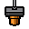

# Layer-by-Layer

A 3D-printing watchface for Pebble. Each minute is a fresh print: digits build
from the bottom up while a nozzle sweeps left and right. When the minute
changes, the finished part drops off the bed and a new print starts. There is
no seconds readout — the nozzle *is* the clock.



## Platforms

Pebble Time 2 (Emery), Pebble Time (Basalt), Pebble 2 / Time Round-class
(Diorite), and Pebble 2 Duo (Flint). Color watches use cyan filament and an
orange nozzle; B&W watches use white on black.

## Build and install

The Pebble SDK runs on Linux and macOS only. On **Windows**, `build.ps1` runs it
in a container (install [Podman Desktop](https://podman-desktop.io) or Docker
Desktop first):

```powershell
./build.ps1
```

The first run builds the container image and downloads the SDK. The watchface
ends up in `build/LayerByLayer.pbw`.

On **macOS/Linux**, [install the SDK](https://developer.repebble.com/sdk) and
run `pebble build`.

Put it on the watch by opening the `.pbw` in the Pebble app, or:

```powershell
./build.ps1 -Phone 192.168.1.23
```

## How the animation works

- Progress through the current minute drives print height (seven glyph layers).
- The nozzle zig-zags across the bed, one pass per layer.
- At the minute boundary the old digits fall away (~0.8 s), then the new time
  starts from an empty bed.
- Frames update every 100 ms while the watchface is open.
